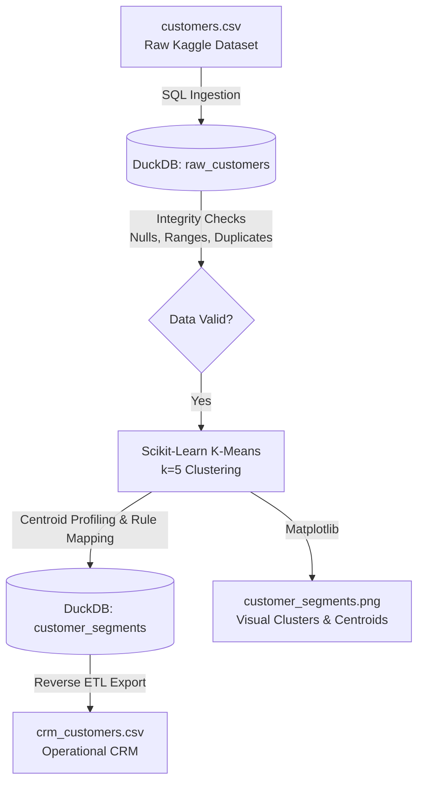

# 🛍️ Customer Segmentation & Reverse ETL Pipeline

An end-to-end demonstration pipeline integrating **Data Engineering (DuckDB)**, **Unsupervised Machine Learning (Scikit-Learn K-Means)**, and **Reverse ETL** into a simulated Customer Relationship Management (CRM) system.

---

## 📌 Project Overview

In real-world data platforms, machine learning models shouldn't just output numbers in a notebook—their predictions and insights need to be pushed back into operational systems where marketing, product, and sales teams can take action. This process is called **Reverse ETL**.

This project demonstrates that entire flow:
1. **Ingests & Validates** customer records from a Kaggle dataset into an embedded analytical database (**DuckDB**).
2. **Performs K-Means Clustering** ($k=5$) on Annual Income and Spending Score using **Scikit-Learn**.
3. **Profiles Segments & Generates Actions**: Automatically assigns human-readable business segment names and targeted marketing recommendations based on cluster centroids.
4. **Pushes Back to CRM (Reverse ETL)**: Exports enriched customer intelligence to a simulated CRM file (`crm_customers.csv`).
5. **Generates Visual Analytics**: Renders a publication-ready cluster scatter plot (`customer_segments.png`) highlighting clusters and centroids.

---

## 🏗️ Architecture & Workflow



---

## 👥 Identified Customer Segments

The K-Means model identified 5 clear customer archetypes from the data:

| Cluster | Segment Name | Avg Income | Avg Spending Score | Business Profile & Recommended Action |
|:---:|:---|:---:|:---:|:---|
| **0** | **Moderate Income, Moderate Spending** | ~$55.3k | ~49.5 | **Steady Mainstream**: Core customer base. Maintain engagement with routine seasonal promotions and standard loyalty points. |
| **1** | **High Income, High Spending** | ~$86.5k | ~82.1 | **VIP Premium Tier**: Highest customer lifetime value. Offer exclusive perks, luxury tier rewards, early product previews, and concierge support. |
| **2** | **Low Income, High Spending** | ~$25.7k | ~79.4 | **Trendsetters / Enthusiasts**: High purchase propensity despite lower earnings. Engage with trendy flash sales, micro-rewards, and Buy-Now-Pay-Later (BNPL) options. |
| **3** | **High Income, Low Spending** | ~$88.2k | ~17.1 | **High Capacity / Low Engagement**: High purchasing power that is underutilized. Target with premium product launches, curated catalogs, and high-value incentives. |
| **4** | **Low Income, Low Spending** | ~$26.3k | ~20.9 | **Price-Conscious Shoppers**: Highly budget-sensitive. Retain with affordable deals, discount coupons, clearance sales, and value bundles. |

---

## 📁 Repository Structure

```
DE/
├── customers.csv              # Input Kaggle Mall Customer dataset (200 records)
├── customer_analytics.duckdb  # Embedded DuckDB database storing tables
├── main.py                    # Complete end-to-end pipeline implementation
├── requirements.txt           # Project dependencies
├── crm_customers.csv          # Reverse ETL output for simulated CRM
├── customer_segments.png      # High-resolution cluster scatter plot
└── README.md                  # Project documentation
```

---

## 📊 Output Schema (`crm_customers.csv`)

| Column | Type | Description |
|:---|:---|:---|
| `CustomerID` | Integer | Unique identifier for each customer |
| `Age` | Integer | Customer age |
| `Annual_Income` | Float | Annual income in thousands of dollars ($k) |
| `Spending_Score` | Integer | Behavioral spending score (1–100) |
| `Cluster` | Integer | Cluster group index (0–4) |
| `Segment_Name` | String | Plain-language segment title |
| `Recommended_Action` | String | Prescribed CRM marketing action |

---

## 🚀 Getting Started

### 1. Prerequisites
Ensure you have **Python 3.9+** installed.

### 2. Install Dependencies
Install all required libraries using pip:

```bash
python -m pip install -r requirements.txt
```

*Required packages:*
- `duckdb`: High-performance embedded analytical SQL database.
- `pandas`: Data manipulation and dataframe conversion.
- `scikit-learn`: Feature scaling and K-Means clustering.
- `matplotlib`: Data visualization.

### 3. Run the Pipeline
Execute the pipeline script:

```bash
python main.py
```

### 4. Review Results
- Inspect the generated CRM file: `crm_customers.csv`
- View the cluster plot: `customer_segments.png`
- Query the DuckDB tables: `customer_analytics.duckdb`

---

## 💡 Notes & Limitations
- **Demonstration Scope**: The dataset contains 200 customer records and lacks timestamped transaction logs. This project serves as an educational demonstration of combining data warehousing, unsupervised ML, and Reverse ETL in Python.
